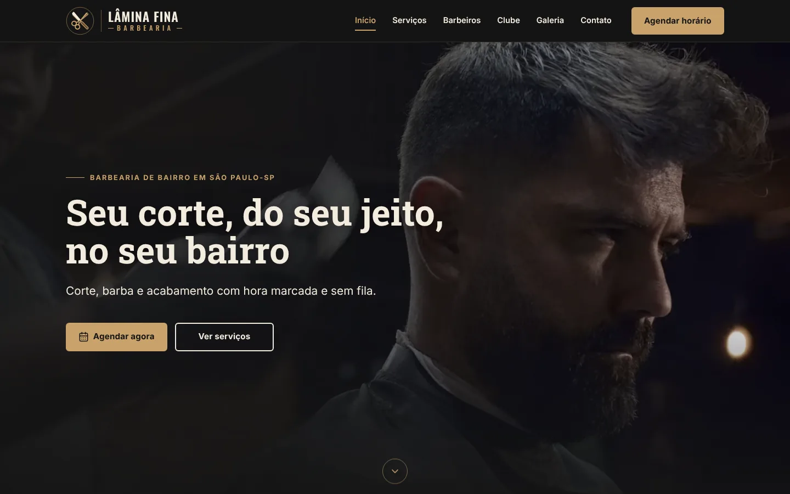

# Lâmina Fina Barbearia

> **Projeto fictício de portfólio.** A Lâmina Fina Barbearia não existe. Os barbeiros, clientes, depoimentos, preços, números e contatos são inventados, e nenhum atendimento real é oferecido. Site desenvolvido por **LS Luccas Souza**.

Site estático completo de uma barbearia de bairro em Suzano-SP, com agendamento online que funciona de verdade no navegador. É feito em HTML, CSS e JavaScript puros, sem framework e sem etapa de build.

**Site publicado:** https://luccas-souza7.github.io/barbearia/



## Destaque: agendamento online funcional

A parte principal do projeto é o agendamento em 3 passos, todo em JavaScript puro (`assets/js/agendamento.js`):

1. **Serviço ou combo:** lista com preço e duração vindos de `dados.js`.
2. **Barbeiro:** um dos quatro barbeiros ou "Sem preferência" (o sistema escolhe o primeiro livre).
3. **Dia e horário:** calendário gerado em JS para o mês atual e o seguinte. O dia de hoje fica destacado. Domingos, segundas e dias que já passaram ficam desabilitados. Os horários vão das 9h às 20h e respeitam a duração do serviço (um serviço de 70 minutos não aparece às 19h).

Mais detalhes:

- Os horários "ocupados" saem de um hash determinístico da data, do barbeiro e do horário. A agenda parece real e é sempre a mesma a cada visita.
- Cada passo tem validação, mensagem de erro acessível e indicador 1, 2 e 3.
- O calendário funciona pelo teclado (setas, Home, End e Enter).
- Os botões "Agendar combo" pré-selecionam o combo e rolam até o agendamento.
- "Confirmar agendamento" abre um resumo (serviço, barbeiro, dia, horário e valor) com o aviso de demonstração. **Nenhum dado é enviado.**
- O último agendamento fica no `localStorage` (com `try/catch`) para mostrar "Seu último agendamento" quando você voltar. Se o visitante recusar no aviso de cookies, nada é gravado.

## Outros recursos

- Cabeçalho fixo, menu hambúrguer no celular e rolagem suave até as seções.
- Números que sobem com animação de contagem quando entram na tela.
- Tabela de preços no estilo cardápio, com a duração aparecendo no hover ou no foco.
- Galeria com filtros (Todos, Degradê, Barba, Clássico, Infantil) e lightbox com setas, teclado e gesto de deslizar.
- Carrossel de depoimentos com setas, teclado e arrasto.
- Perguntas frequentes em acordeão com `<details>`.
- Modais demonstrativos no lugar de WhatsApp, Instagram, assinatura e reserva de produtos.
- Banner de cookies (Aceitar, Recusar, Saiba mais), botão flutuante de WhatsApp e botão de voltar ao topo.
- Páginas de Termos de Uso, Política de Privacidade (LGPD), Política de Cookies, Regras do Clube (com o art. 49 do CDC), um guia de cuidados e uma página 404 personalizada.
- Catálogo do design system em [`design-system.html`](design-system.html).

## Tecnologias

- HTML5 semântico
- CSS puro com variáveis (custom properties), Grid e Flexbox
- JavaScript puro (ES5+), sem dependências
- SVG para emblema, poste de barbeiro, coroa, frascos e ícones (sprite Lucide local)
- GitHub Pages para a hospedagem

## Estrutura de pastas

```text
.
├── index.html                  # página inicial
├── termos-de-uso.html
├── politica-de-privacidade.html
├── politica-de-cookies.html
├── regras-do-clube.html
├── cuidados.html               # guia de cuidados entre as visitas
├── 404.html
├── design-system.html          # catálogo de componentes
├── assets/
│   ├── css/
│   │   ├── styles.css          # todo o visual do site
│   │   └── design-system.css   # ajustes de layout do catálogo
│   ├── js/
│   │   ├── dados.js            # serviços, combos, barbeiros, produtos, depoimentos...
│   │   ├── main.js             # montagem das seções e interações
│   │   ├── agendamento.js      # agendamento em 3 passos
│   │   └── design-system.js
│   ├── img/                    # fotos em WebP, imagem de compartilhamento e print
│   └── icons/                  # sprite de ícones e favicon
├── referencia/                 # imagem de referência e wireframe
├── sitemap.xml
├── robots.txt
├── CREDITOS.md
└── LICENSE
```

## Decisões de design

**Paleta.** Só cinco cores, definidas como variáveis em `:root` e usadas em tudo, menos nas fotos:

| Token | Hex | Uso |
|---|---|---|
| `--preto-carvao` | `#151515` | fundo principal, cabeçalho, rodapé |
| `--grafite` | `#2A2A2A` | cards e seções alternadas |
| `--dourado` | `#C8A26B` | botões, ícones, destaques, filetes |
| `--couro` | `#6B4A32` | faixa do clube, etiquetas |
| `--creme` | `#F3EBDD` | títulos sobre fundo escuro, seções claras, texto |

As texturas de madeira e couro são feitas só com gradientes CSS dessas cores, sem imagens pesadas.

**Tipografia.** Roboto Slab nos títulos, Inter no texto e Oswald no logotipo. Todas do Google Fonts (licença OFL), com `display=swap`.

**Acessibilidade.**

- Contraste AA conferido. O dourado só aparece em texto sobre carvão e grafite (7,7:1 e 6,0:1). Nas seções claras, os destaques usam couro (6,7:1).
- Foco visível em todos os elementos interativos.
- Navegação por teclado no menu, no agendamento, no calendário, nos modais (`<dialog>`), no lightbox, no carrossel e no acordeão.
- Link "Pular para o conteúdo", `aria-*` nos componentes dinâmicos, `alt` em todas as imagens e `lang="pt-BR"`.
- Todas as animações respeitam `prefers-reduced-motion`.

**Desempenho.** Imagens em WebP com `width` e `height`, `loading="lazy"` (menos no hero, que tem `preload`), ícones num único sprite SVG e nenhum framework. No Lighthouse local, todas as categorias ficaram acima de 90.

**SEO.** `title` e `meta description` por página, Open Graph com imagem de compartilhamento, favicon SVG do emblema, `sitemap.xml`, `robots.txt` e JSON-LD do tipo `WebSite`.

## Como adaptar para outra barbearia

Quase tudo o que muda de um cliente para outro está em **`assets/js/dados.js`**:

- `negocio`: nome, telefone, e-mail, endereço, dias fechados e horário de funcionamento (usados pelo agendamento).
- `servicos` e `combos`: nome, preço e duração em minutos. A tabela de preços, os cards de combo e o agendamento se atualizam sozinhos.
- `barbeiros`: nome, especialidade e foto.
- `planosClube`, `produtos`, `depoimentos`, `galeria` e `perguntas`.

Para mudar a identidade visual, troque as cinco variáveis de cor no início de `assets/css/styles.css` e as fontes no `<link>` do Google Fonts. Os textos fixos (hero, sobre, rodapé e páginas legais) estão direto nos arquivos HTML.

## Como rodar localmente

Não precisa instalar nada. Na pasta do projeto:

```bash
python -m http.server 8000
```

Depois abra http://localhost:8000 no navegador.

## Créditos e licença

- Fotos de domínio público (CC0), fontes OFL e ícones Lucide (ISC). A lista completa está em [CREDITOS.md](CREDITOS.md).
- Código e textos: todos os direitos reservados, Luccas Souza, 2026. É permitida apenas a visualização para avaliação de portfólio. Veja [LICENSE](LICENSE).

## Autor

**Luccas Souza** (LS Luccas Souza)

- GitHub: [github.com/luccas-souza7](https://github.com/luccas-souza7)
- LinkedIn: [linkedin.com/in/luccas-souza7](https://www.linkedin.com/in/luccas-souza7)
